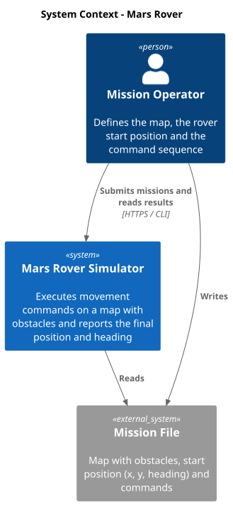

# 3. System Scope and Context

The Mars Rover Simulator is the system under design. Its boundary contains the
pure navigation engine and two thin delivery adapters (CLI and HTTPS API).
Everything outside the boundary is either the mission operator or a tool the
operator uses. The engine itself neither reads files nor calls external
services.

## 3.1 Business Context


([PlantUML source](diagrams/c4-context.puml))

| External entity | Role in a mission | Interface |
| --- | --- | --- |
| Mission Operator | Defines a rectangular map with obstacles, the rover start position and heading, and the command sequence; reads the result. | Writes a mission file or uses an HTTP client. |
| Mission File | Carries a self-contained mission into a local run. | JSON file read by the CLI adapter. |
| HTTP Client | Submits a mission remotely (for example `curl`). | HTTPS JSON request and response through API Gateway. |

A mission is a single value: map dimensions, obstacle cells, start cell,
heading and commands. The operator submits it once and receives the final cell
and heading. A forward move into an obstacle or past the map boundary is a
no-op, and there is no wrap-around (ADR-002). No mission history leaves the
system (ADR-001).

## 3.2 Technical Context

### Mission input

Both adapters accept the same JSON payload. Cells are indexed from `(0, 0)` at
the lower-left corner: `x` increases east, `y` increases north, so `N` moves to
`y + 1` and `E` moves to `x + 1`. Coordinates outside `0..width-1` and
`0..height-1` are outside the map.

```json
{
  "map": {"width": 5, "height": 4, "obstacles": [[2, 2], [3, 1]]},
  "start": {"x": 1, "y": 1, "heading": "N"},
  "commands": "FFLFR"
}
```

`heading` is one of `N`, `E`, `S`, `W`; `commands` is a string over `F`, `L`,
`R`, applied left to right.

### Result output

```json
{"x": 1, "y": 3, "heading": "E"}
```

Only the final cell and heading are returned; no trace or history is produced.

### Channels and boundaries

- **CLI:** the adapter takes a path to a mission JSON file, calls the engine
  and prints the result JSON to stdout. It is the only component that reads a
  mission file.
- **HTTPS API:** API Gateway forwards a `POST` request with the mission JSON to
  the Lambda adapter, which calls the engine and returns the result JSON
  (malformed missions are rejected at the adapter, as defined in Chapter 8).
- **Engine boundary:** both adapters call one engine function with the mission
  as domain values; the engine has no knowledge of files, HTTP, API Gateway or
  Lambda.
- **No external storage or downstream services:** there is no database, queue,
  cache or third-party API. AWS deployment details belong to Chapter 7.
