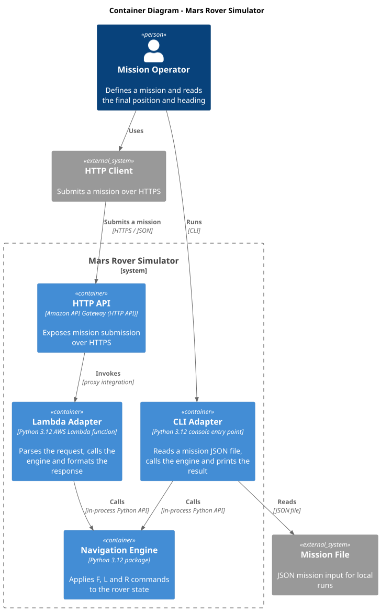
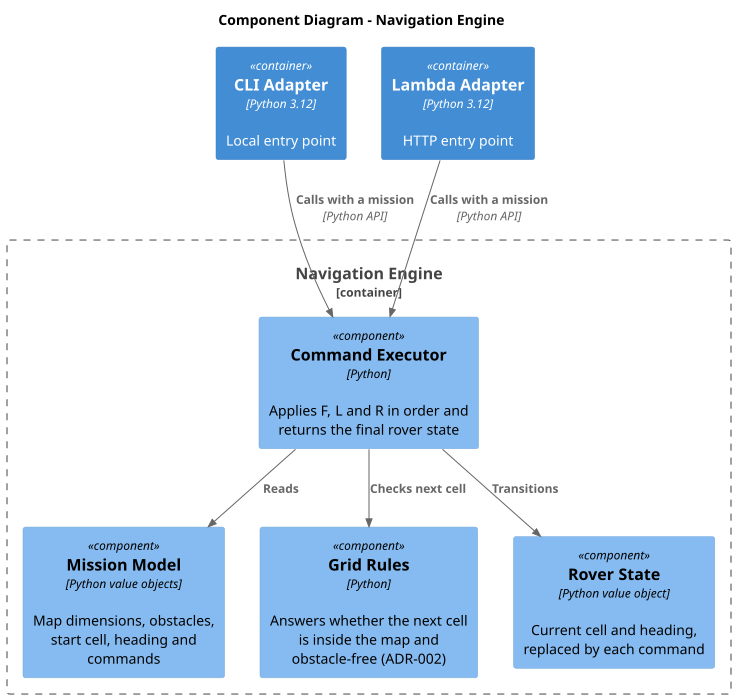

# 5. Building Block View

The system boundary contains four building blocks at the container level. Only
the navigation engine has non-trivial internal structure; the two adapters are
thin translators around the same engine call.

## 5.1 Level 1: Containers

([PlantUML source](diagrams/c4-container.puml))

| Building block | Technology | Responsibility |
| --- | --- | --- |
| CLI Adapter | Python 3.12 console entry point | Reads a mission JSON file, calls the engine, prints the result JSON. |
| HTTP API | Amazon API Gateway HTTP API | Exposes the HTTPS endpoint and forwards each request to the Lambda function. |
| Lambda Adapter | Python 3.12 AWS Lambda function | Parses the request, calls the engine and formats the HTTP response. |
| Navigation Engine | Python 3.12 package | Applies the command sequence to the rover state; pure domain logic. |

The Mission File and the HTTP Client are external entities; their relationships
to the operator and the system are shown in Chapter 3. There is no storage
container because missions are self-contained (ADR-001).

## 5.2 Level 2: Navigation Engine

([PlantUML source](diagrams/c4-component-engine.puml))

| Component | Responsibility |
| --- | --- |
| Mission Model | Value objects for map dimensions, obstacles, start cell, heading and commands. |
| Command Executor | Applies `F`, `L` and `R` left to right and returns the final rover state. |
| Grid Rules | Answers whether the next cell is inside the map and obstacle-free; owns the no-op behavior of ADR-002. |
| Rover State | Immutable cell plus heading; each command produces a replacement state. |

API Gateway is a managed service with no internal components. The adapters are
thin enough to describe in text, so no separate component diagrams are needed:

- **CLI Adapter:** a mission-file reader and a result printer. It parses the
  JSON file, calls the engine and writes the result JSON to stdout.
- **Lambda Adapter:** a request parser and a response formatter. It maps the
  API Gateway event to a mission value and the engine result to a JSON
  response; validation and error status codes are covered in Chapter 8.

## 5.3 Interfaces Between Building Blocks

| From | To | Interface |
| --- | --- | --- |
| CLI Adapter, Lambda Adapter | Navigation Engine | In-process Python call `execute(mission) -> result`; mission and result are domain values. |
| Mission Operator | CLI Adapter | Path to a mission JSON file; result JSON on stdout. |
| HTTP Client | HTTP API | HTTPS `POST` with the mission JSON from Chapter 3; result JSON in the response body. |
| HTTP API | Lambda Adapter | API Gateway proxy event containing the request; response dictionary. |

The engine never calls outward: no adapter, file, socket or AWS SDK appears in
its package. No building block shares mutable state with another.

## 5.4 Internal Data Model

- **Cell:** integer `(x, y)`, counted from the lower-left corner.
- **Heading:** enum `N`, `E`, `S`, `W`.
- **Map:** width, height and a set of obstacle cells.
- **Mission:** map, start cell, initial heading and command string.
- **Rover State:** current cell and heading.
- **Result:** final cell and heading, as defined in Chapter 3.

All values are created per mission and discarded afterwards; no caching or
persistence layer exists.
