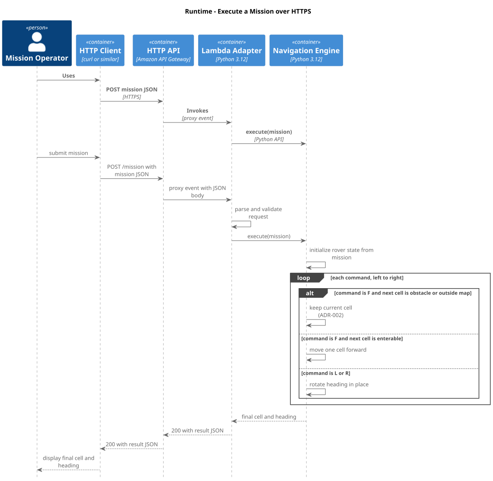
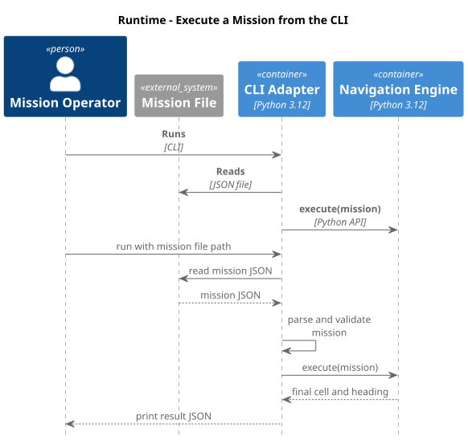

# 6. Runtime View

Both delivery channels trigger the same in-process engine call. A mission is
processed as one synchronous unit: commands are applied strictly left to right
and the final cell and heading are returned to the caller.

## 6.1 Execute a Mission over HTTPS

([PlantUML source](diagrams/sequence-http-mission.puml))

1. The operator sends the mission JSON from an HTTP client to the API Gateway
   HTTP API.
2. API Gateway forwards the request event to the Lambda adapter.
3. The adapter parses and validates the request and builds the mission value.
4. The adapter calls `execute(mission)` on the engine.
5. The engine initializes the rover state and processes each command. For `F`
   it asks Grid Rules whether the next cell is inside the map and obstacle-free;
   a blocked move leaves the cell unchanged (ADR-002). `L` and `R` rotate the
   heading in place.
6. The engine returns the final cell and heading; the adapter wraps them in a
   JSON response and API Gateway returns it to the client.

## 6.2 Execute a Mission from the CLI

([PlantUML source](diagrams/sequence-cli-mission.puml))

1. The operator invokes the CLI with a path to a mission JSON file.
2. The CLI adapter reads and validates the file, then builds the mission value.
3. The adapter calls the same `execute(mission)` function as the Lambda adapter.
4. The adapter prints the result JSON to stdout.

No network call, AWS service or persistent state is involved in a CLI run.

## 6.3 Blocked Move Example

Map `5 x 4`, start `(1, 1)` heading `N`, obstacle at `(1, 2)`, commands `FFR`:

| Step | Command | Check | State afterwards |
| --- | --- | --- | --- |
| 0 | - | - | `(1, 1)`, `N` |
| 1 | `F` | `(1, 2)` is an obstacle | `(1, 1)`, `N` |
| 2 | `F` | `(1, 2)` is an obstacle | `(1, 1)`, `N` |
| 3 | `R` | turn in place | `(1, 1)`, `E` |

Result: `{"x": 1, "y": 1, "heading": "E"}`. Each blocked `F` consumes its
command but does not end the mission. Likewise, from `(4, 3)` heading `N` in
the same map, `F` would leave the map and is a no-op; the rover stays at the
boundary cell with no wrap-around.

## 6.4 Runtime Characteristics

- Synchronous request/response; one mission per call, with no session, queue or
  background job.
- No shared mutable state: concurrent Lambda invocations and repeated CLI runs
  are independent and deterministic.
- Command order is preserved; no command is skipped except a blocked `F`, which
  is still accounted for as a no-op.
- Malformed missions are rejected in the adapter before the engine is called;
  error handling and status codes are specified in Chapter 8.
- The first API request may incur a Lambda cold start (ADR-001); normal
  command lists are short and need no timeout or scaling configuration.
