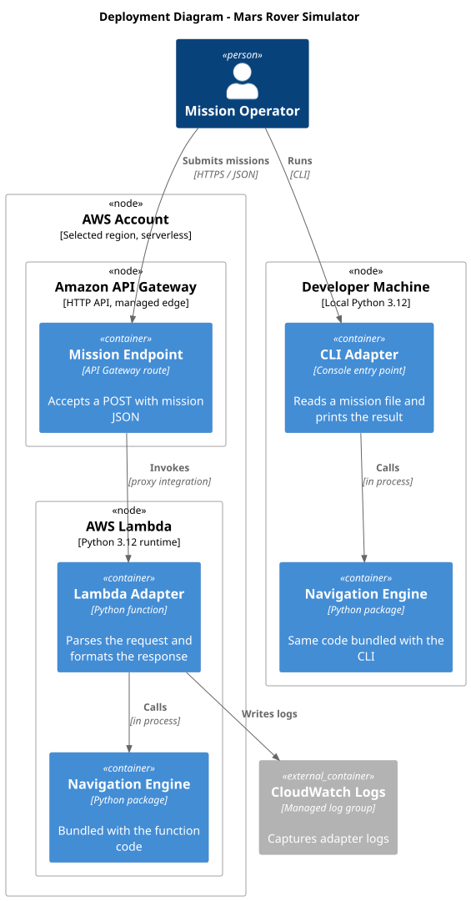

# 7. Deployment View

The same navigation engine is deployed twice: bundled into the Lambda function
for remote missions and installed locally with the CLI. No stateful
infrastructure is deployed.

## 7.1 Deployment Diagram

([PlantUML source](diagrams/c4-deployment.puml))

## 7.2 AWS Environment

- **Region:** chosen at deploy time; one stack per environment (for example
  development and production) created from the same AWS SAM template.
- **API Gateway HTTP API:** public HTTPS route accepting a mission JSON `POST`;
  proxy integration forwards the event to the Lambda function. No custom
  domain, cache or authorizer is required.
- **AWS Lambda:** Python 3.12 runtime. The deployment package contains the
  Lambda adapter and the navigation engine. Execution is stateless, scales to
  zero and needs no reserved concurrency or special timeout.
- **IAM:** the function execution role grants CloudWatch Logs access only. No
  database, S3 or VPC permissions are needed.
- **CloudWatch Logs:** managed log group for adapter diagnostics; the engine
  itself has no logging dependency.
- **Absent infrastructure:** no VPC, database, queue, file system, container
  cluster or always-on server.

## 7.3 Local Environment

- A Python 3.12 interpreter on the developer machine runs the CLI entry point
  from the same source package used by the Lambda function.
- The operator supplies a mission JSON file; the result is printed to stdout.
- Local runs need no AWS credentials, network connection or deployed stack.

## 7.4 Building Block Placement

| Building block (Chapter 5) | Runtime location |
| --- | --- |
| CLI Adapter | Developer machine, local Python 3.12 process. |
| HTTP API | Amazon API Gateway HTTP API in the chosen region. |
| Lambda Adapter | AWS Lambda function, Python 3.12 runtime. |
| Navigation Engine | Bundled with the CLI and with the Lambda function; no separate deployment. |
| CloudWatch Logs | AWS managed log group for the Lambda function. |

## 7.5 Deployment and Operations

- An AWS SAM template (`template.yaml`) defines the API, function, execution
  role and stack outputs; deployment is performed with the AWS SAM CLI.
- The API endpoint is read from the stack output. Deleting the stack removes
  all resources; there is no stored data to migrate or back up.
- The first API request may experience a Lambda cold start (ADR-001); later
  requests reuse warm execution environments when available.
- Environments are independent stacks with no shared state, so a change in one
  cannot affect another.
